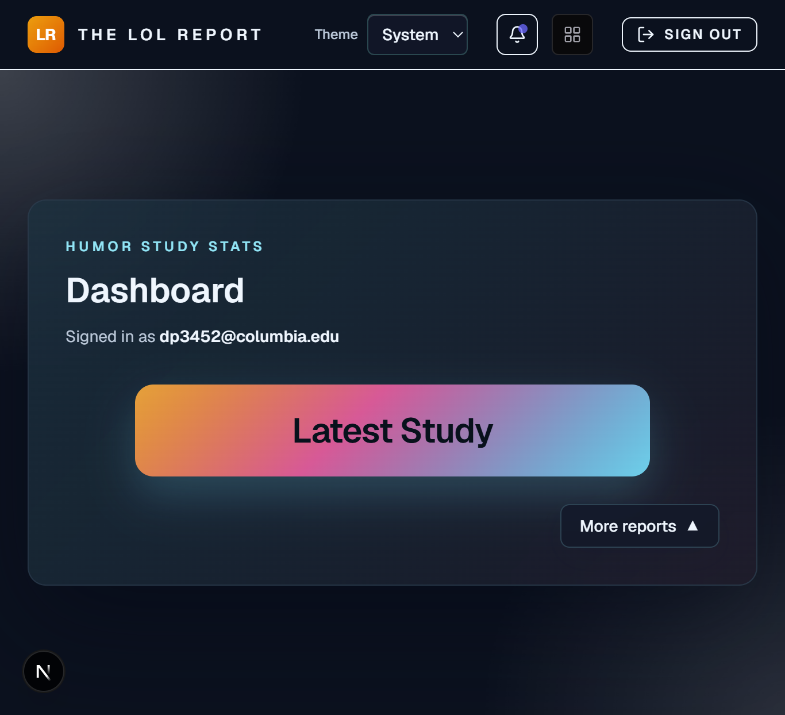
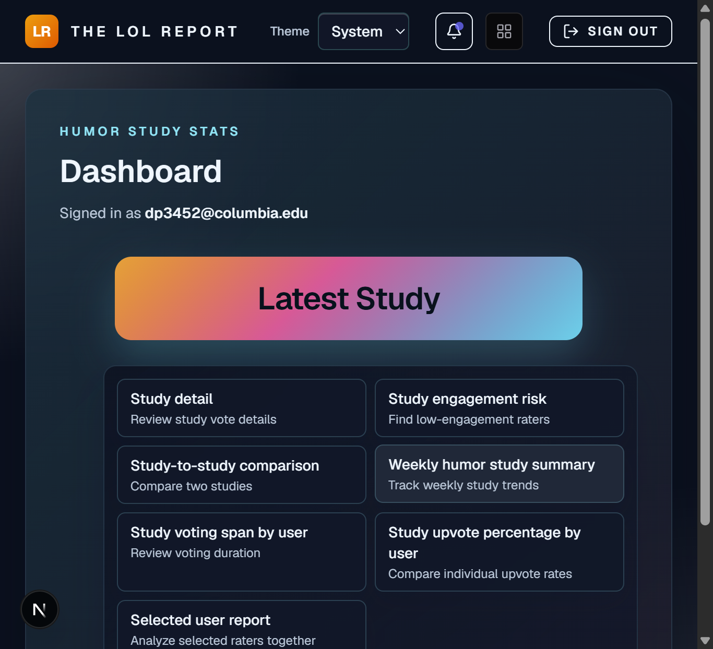
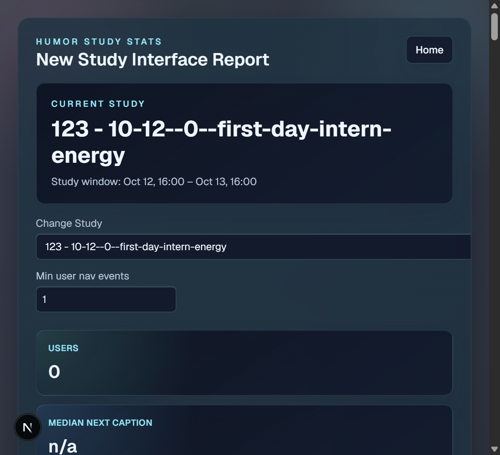
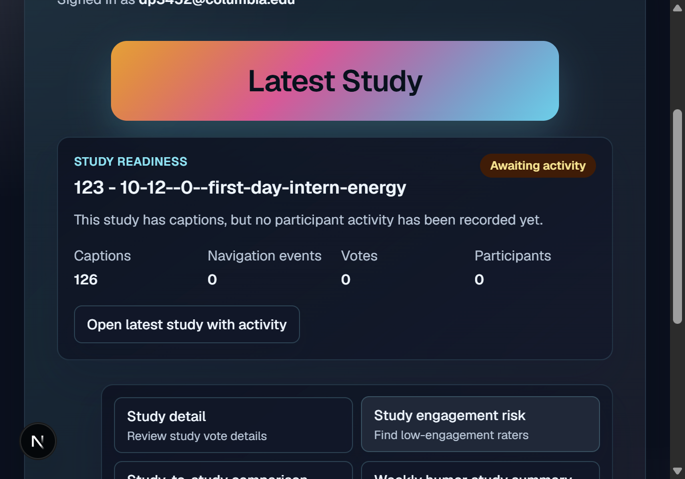
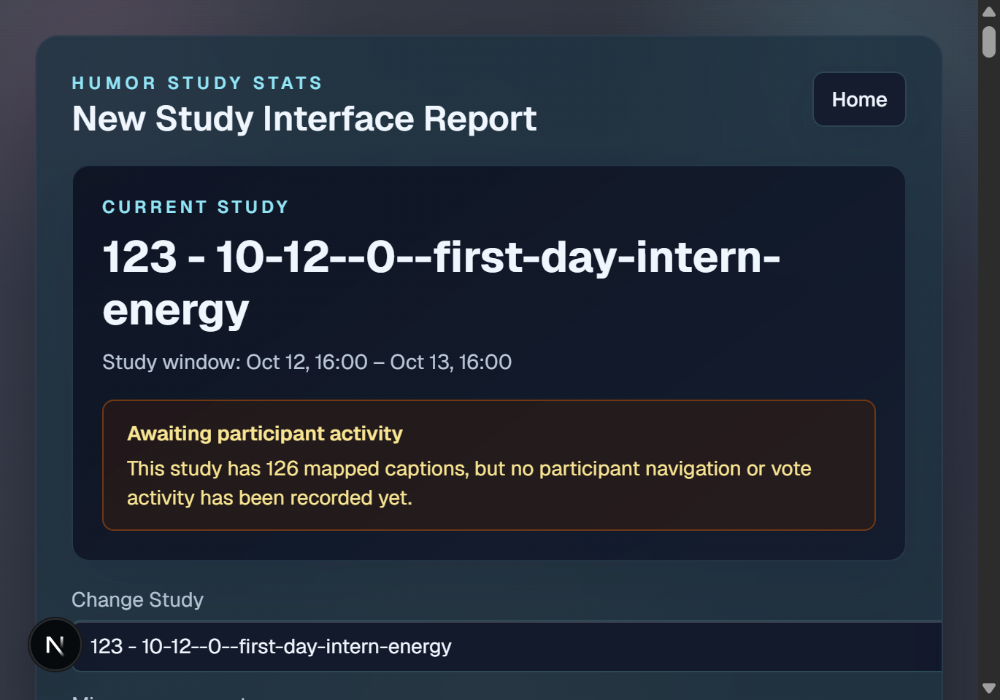

# Original problems to solve

The newest study opened automatically even when it had captions but no
participant activity. The empty metrics did not explain whether the study was
inactive, had low engagement, or had failed to load.

The dashboard also used a large full-width Latest Study button, which made the
primary action visually overpower the rest of the page.

When expanded, the More reports control kept the same label and used a
confusing triangle orientation, making its open state less clear.

The study report showed the study name, date range, and empty metrics without
explaining that mapped captions existed but participant activity had not yet
been recorded.

# Dev log

## October 30, 2026

- Restored the shared teaching database into a new Supabase project.
- Configured local Supabase and Google OAuth environment variables.
- Verified local sign-in and report access.

## November 3, 2026

- Added a study-readiness card below the Latest Study button. It shows the selected study's caption, navigation-event, vote, and participant counts.
- Added clear activity messaging for studies with recorded participation and studies that have captions but no participant activity yet.
- Added a link to the latest study with activity when the newest study is still inactive.
- Added the same activity explanation to the new study report, including the latest recorded activity time when available.
- Changed the dashboard visually by making the Latest Study button thinner and more compact instead of using a large full-width panel.
- Changed the More reports control so it says "More reports" when closed and "Hide reports" when open. Its triangle points down when closed and up when open, making the interaction state clearer.
- Confirmed the production build passes.
- Added a database security-hardening script that enables RLS and removes anonymous access from the study analytics tables. The report app's authenticated superadmin access remains available through explicit policies.
- Captured visual snapshots after the implementation:
  - The dashboard now displays the compact Latest Study button, study-readiness card, and Hide reports/upward-triangle state:

    

  - The report now displays the warning message explaining that captions exist but participant activity has not been recorded:

    
