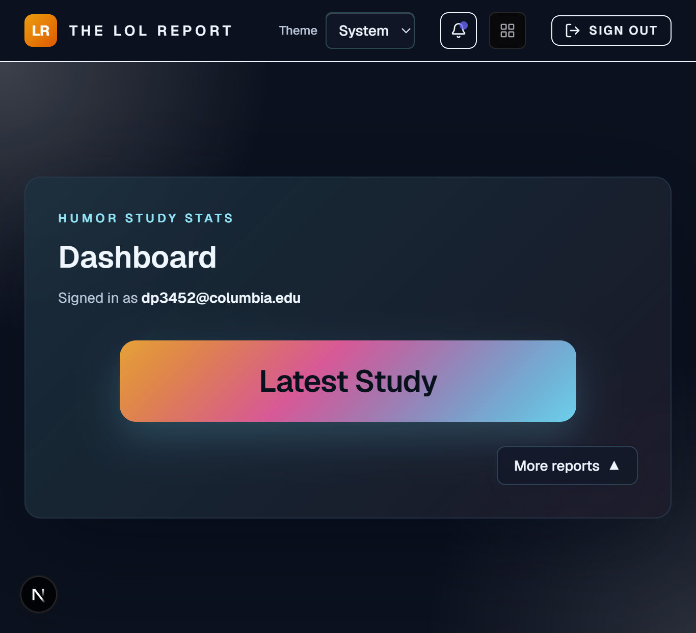
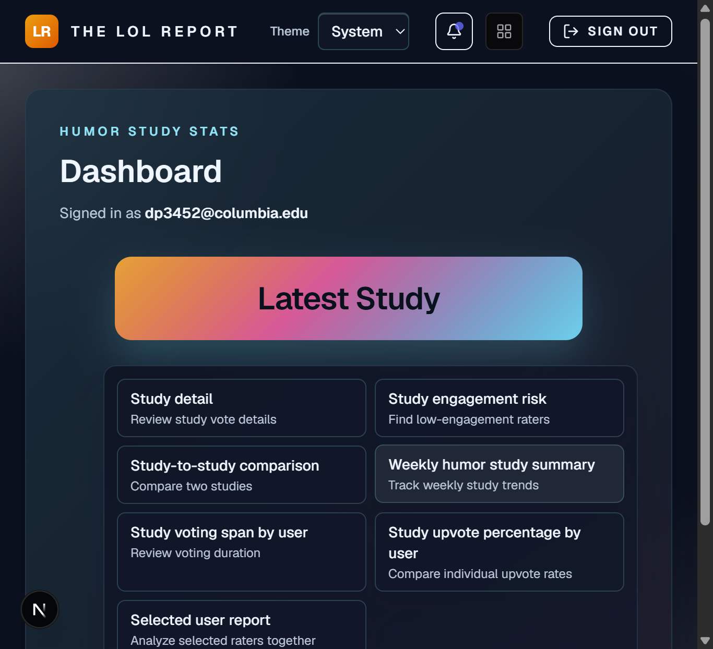
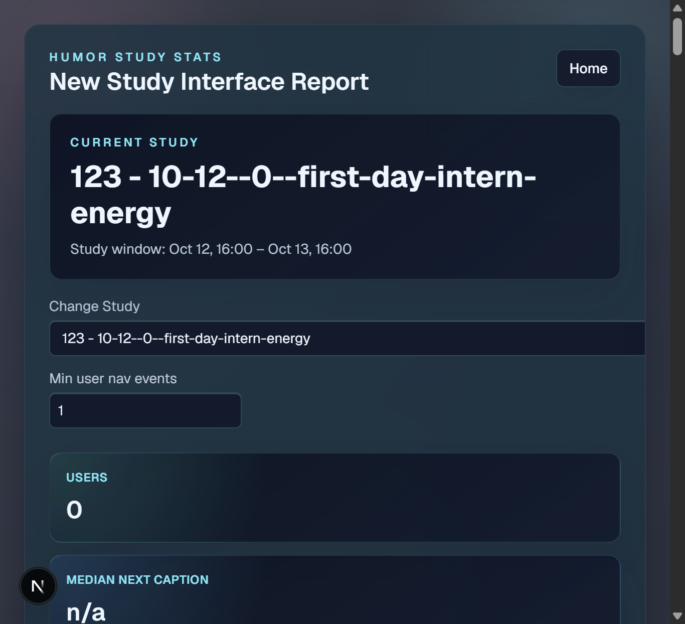
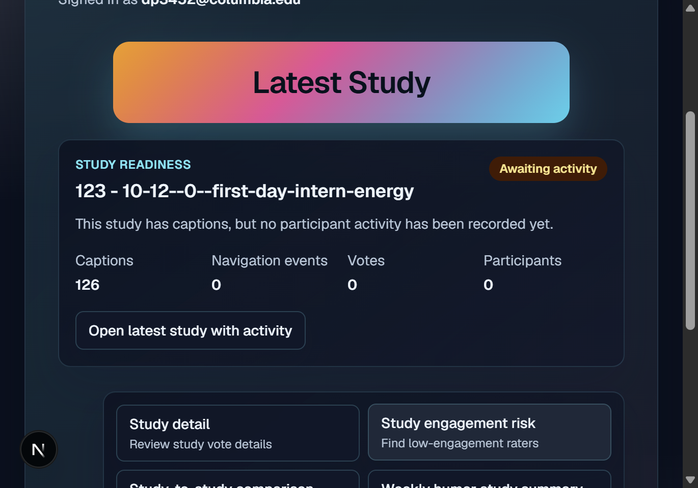
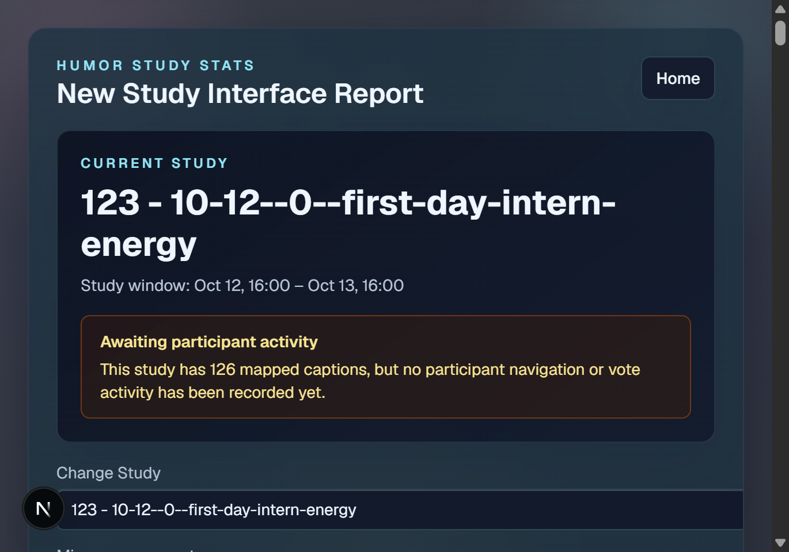
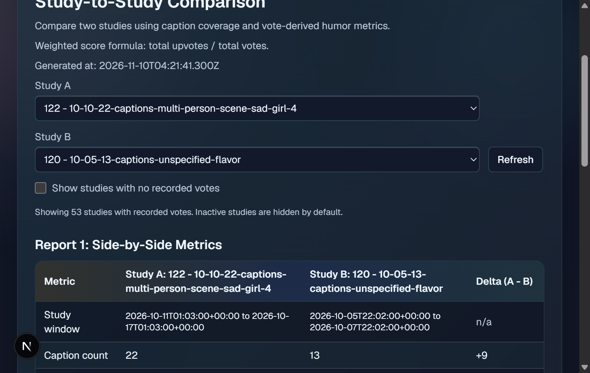
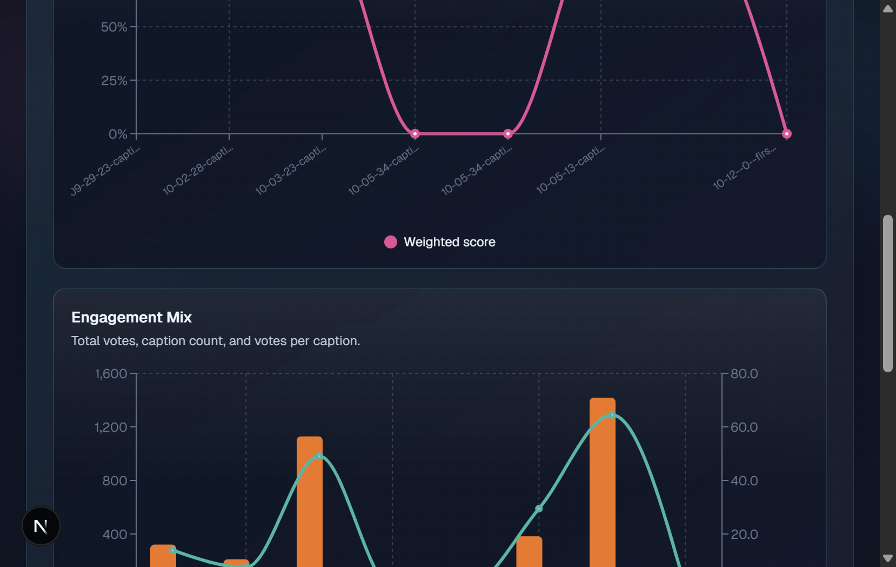
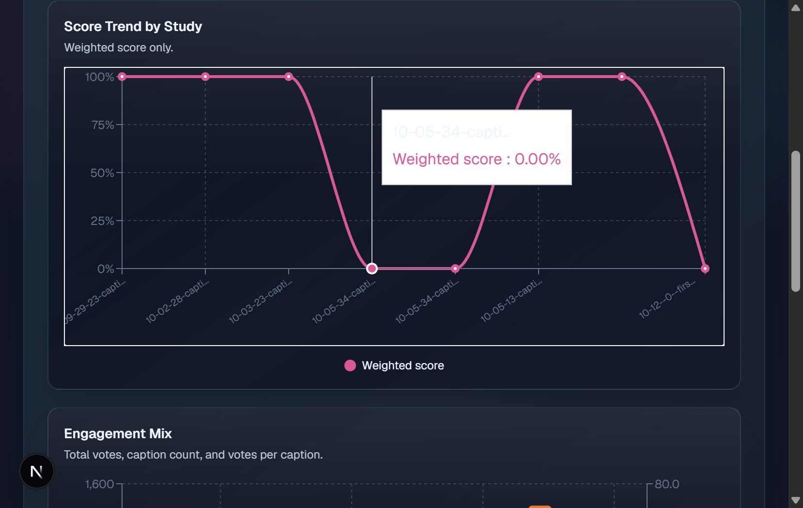
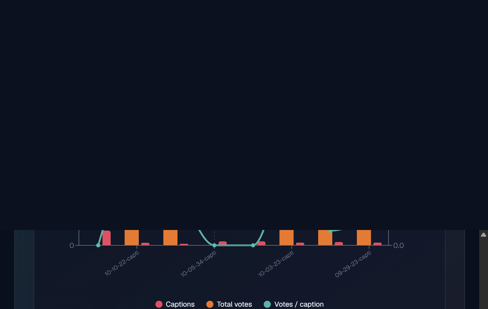

# Original problems to solve

The newest study opened automatically even when it had captions but no
participant activity. The empty metrics did not explain whether the study was
inactive, had low engagement, or had failed to load.

The dashboard also used a large full-width Latest Study button, which made the
primary action visually overpower the rest of the page.

When expanded, the More reports control kept the same label and used a
confusing triangle orientation, making its open state less clear.

The study report showed the study name, date range, and empty metrics without
explaining that mapped captions existed but participant activity had not yet
been recorded.

# Dev log

## October 30, 2026

- Restored the shared teaching database into a new Supabase project.
- Configured local Supabase and Google OAuth environment variables.
- Verified local sign-in and report access.

## November 3, 2026

- Added a study-readiness card below the Latest Study button. It shows the selected study's caption, navigation-event, vote, and participant counts.
- Added clear activity messaging for studies with recorded participation and studies that have captions but no participant activity yet.
- Added a link to the latest study with activity when the newest study is still inactive.
- Added the same activity explanation to the new study report, including the latest recorded activity time when available.
- Changed the dashboard visually by making the Latest Study button thinner and more compact instead of using a large full-width panel.
- Changed the More reports control so it says "More reports" when closed and "Hide reports" when open. Its triangle points down when closed and up when open, making the interaction state clearer.
- Confirmed the production build passes.
- Added a database security-hardening script that enables RLS and removes anonymous access from the study analytics tables. The report app's authenticated superadmin access remains available through explicit policies.
- Captured visual snapshots after the implementation:
  - The dashboard now displays the compact Latest Study button, study-readiness card, and Hide reports/upward-triangle state:

    

  - The report now displays the warning message explaining that captions exist but participant activity has not been recorded:

    

## Iteration 2

> **Pain point:** Analysts could see study statistics, but could not quickly understand what the metrics meant, compare studies confidently, or read the crowded charts. Zero-activity studies and slow comparison refreshes made the reports feel ambiguous and inefficient to use.

- Added a study comparison workspace with plain-language metric explanations, visual comparisons, overlap and delta metrics, sample-size context, and inactive-study filtering.

  

- Standardized report navigation across the dashboard and study reports, and optimized comparison refreshes to load only the selected pair with transition feedback.
- Added the Weekly Summary report with clickable score, engagement, and participation charts, readable diagonal labels, separate legends, and focused expanded-chart views.

  

  

- Simplified the dashboard to show the Engagement Mix chart and a View all graphs action, while retaining the study-readiness context.

  

## Iteration 3

> **Pain point:** Analysts can see the metrics, but still need to decide what action to take. Reports should connect a finding to a practical next step while showing what the available evidence cannot establish.

- Added a “What should you do?” action card to the dashboard, Study Comparison, and Weekly Summary. Each card separates the finding, recommended next step, and confidence caveat.
- The dashboard distinguishes no recorded activity, limited votes, and activity suitable for an initial review. Recommendations include checking data collection, waiting for more responses, and reviewing caption coverage, vote mix, and participant-level outliers.
- Study Comparison now directs analysts to inspect overlap, vote volume, and participant coverage before acting on differences. It cautions that the comparison is descriptive and cannot establish causation.
- Weekly Summary highlights a low-evidence study when one is present; otherwise, it points analysts to the study with the most votes and recommends comparisons with similar caption and participant coverage. Vote-count cues are decision aids, not validated statistical readiness thresholds.
- **Validation:** Production build and targeted ESLint passed after the feedback UI was removed. The next review should test whether analysts find the recommended actions useful and calibrate the simple evidence cues against real study workflows.
